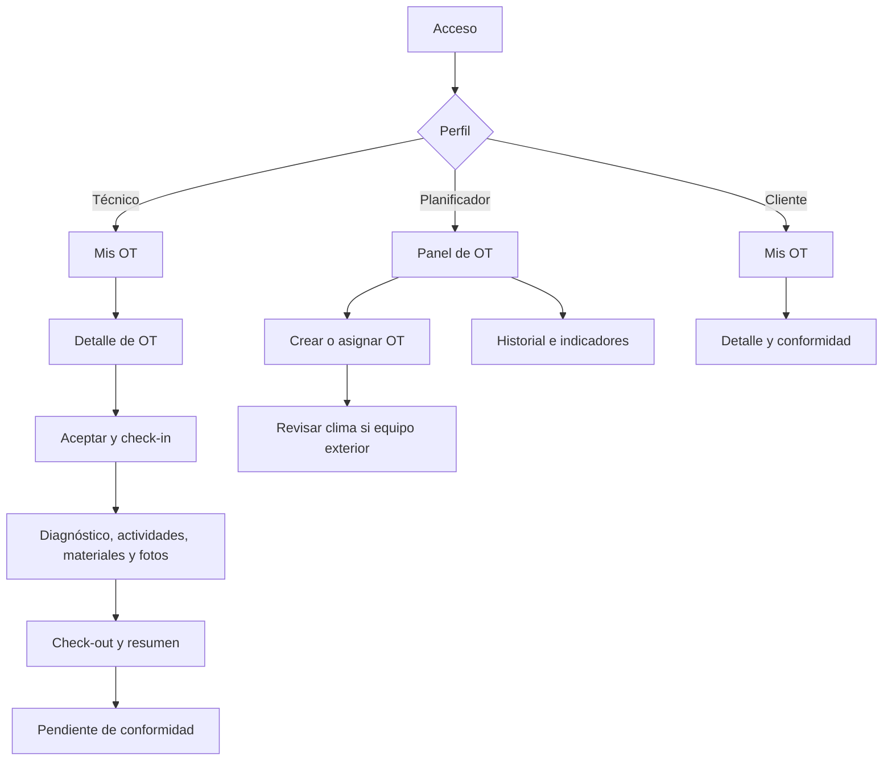
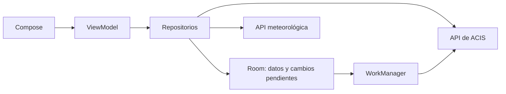

# ACIS: requisitos, navegación y arquitectura propuesta

Estado: propuesta inicial para revisar antes de implementar.

Fuente del problema: *Caso_DSY1105 _ACIS.pdf*, secciones 2 a 5. El caso describe las necesidades de la empresa; las decisiones técnicas y reglas detalladas de este documento son propuestas del equipo, no instrucciones del caso.

Base del proyecto revisada: aplicación Android creada en Kotlin con Jetpack Compose, un módulo `app`, `MainActivity` de ejemplo, `minSdk` 24 y `targetSdk` 37. Aún no contiene funciones de ACIS. No hay pauta ni rúbrica disponibles por ahora; el alcance se ajustará cuando lleguen.

## 1. Alcance y requisitos

### Objetivo

Registrar el ciclo completo de cada orden de trabajo (OT) de mantenimiento de climatización o refrigeración: planificación, asignación, ejecución en terreno, evidencias, conformidad del cliente y consulta de tiempos/SLA. El técnico debe poder registrar su trabajo sin conexión y sincronizarlo al recuperar señal.

### Perfiles

| Perfil | Responsabilidad principal |
| --- | --- |
| Técnico | Consultar y aceptar OT asignadas; registrar visita, diagnóstico, actividades, materiales y fotos; enviar el cierre de su intervención. |
| Planificador o jefatura | Mantener OT, priorizarlas, asignarlas, consultar avance, revisar alertas climáticas e indicadores. |
| Cliente o administrador del local | Consultar las OT de sus locales y registrar conformidad u observaciones. |

### Requisitos funcionales

| ID | Requisito | Prioridad propuesta | Origen |
| --- | --- | --- | --- |
| RF-01 | Identificar al usuario y mostrar únicamente las funciones y datos autorizados para su perfil. | Alta | Propuesta necesaria para los tres perfiles. |
| RF-02 | Mantener clientes, locales y equipos, con ubicación del equipo y fecha de última mantención. | Alta | Caso, 3.2. |
| RF-03 | Crear OT con local, equipo, tipo, prioridad, descripción, fecha prevista y técnico asignado. | Alta | Caso, 3.1 y 3.2. |
| RF-04 | Mostrar al técnico sus OT y permitirle aceptarlas. | Alta | Caso, 2.4. |
| RF-05 | Registrar check-in y check-out con fecha y hora; guardar ubicación solo cuando corresponda a ese registro y exista permiso. | Alta | Caso, 3.3 y 5.1. |
| RF-06 | Registrar diagnóstico, actividades realizadas, materiales utilizados y fotografías asociadas a la OT. | Alta | Caso, 3.1 a 3.3. |
| RF-07 | Guardar los registros de terreno sin señal y sincronizarlos automáticamente al recuperar conectividad, mostrando su estado de sincronización. | Alta | Caso, 3.3 y 5.1; indicador visible propuesto. |
| RF-08 | Permitir al cliente consultar el estado de sus OT y validar la conformidad o dejar observaciones. | Media | Caso, 3.1. |
| RF-09 | Consultar un pronóstico meteorológico público y alertar antes de agendar trabajos en unidades exteriores si hay lluvia o viento fuerte. | Media | Caso, 3.4. |
| RF-10 | Consultar tiempos de atención y cumplimiento de SLA por cliente/OT. | Media | Caso, 2.3 y 4.1. |
| RF-11 | Conservar una línea de tiempo de cambios relevantes de la OT: creación, asignación, aceptación, visita, intervención, conformidad y cierre. | Alta | Propuesta para dar trazabilidad al ciclo solicitado. |

### Requisitos no funcionales

| ID | Requisito | Criterio inicial de aceptación |
| --- | --- | --- |
| RNF-01 | Operación sin conexión. | Un técnico puede abrir una OT descargada y guardar check-in, check-out, diagnóstico y fotos en modo avión; al volver la conexión, se envían sin duplicar registros. |
| RNF-02 | Registro rápido. | El formulario de terreno presenta campos indispensables primero, permite guardar borrador y evita volver a escribir datos ya conocidos del local/equipo. |
| RNF-03 | Privacidad. | Solo se pide ubicación durante acciones que la requieren; fotos y ubicación se vinculan a la OT, se restringen por perfil y no se muestran a usuarios ajenos al cliente/local. |
| RNF-04 | Trazabilidad. | Cada cambio relevante conserva actor, fecha/hora y estado, incluso si se registró primero sin conexión. |
| RNF-05 | Claridad de sincronización. | La app distingue datos guardados localmente, pendientes, sincronizados y con error; un fallo conserva los datos para reintento. |

### Historias de usuario prioritarias

| ID | Historia | Criterios de aceptación resumidos |
| --- | --- | --- |
| HU-01 | Como planificador, quiero crear y asignar una OT para que el técnico sepa qué equipo atender y cuándo. | La OT exige local, equipo, tipo, prioridad y fecha; solo un técnico autorizado puede verla como asignada; la asignación queda en el historial. |
| HU-02 | Como técnico, quiero ver mis OT y aceptarlas para organizar mi jornada. | Ve las OT asignadas con local, equipo, prioridad y fecha; puede aceptar una OT; el estado cambia y queda registrado. |
| HU-03 | Como técnico, quiero marcar mi llegada y salida para medir el tiempo real de atención. | Se guardan hora y OT de ambos eventos; funciona sin señal; no se permite un check-out anterior al check-in. |
| HU-04 | Como técnico, quiero registrar diagnóstico, actividades, materiales y fotos para documentar la intervención. | Puede guardar un borrador sin conexión; el cierre solicita los datos mínimos acordados; las fotos quedan asociadas a la OT y muestran si aún deben subirse. |
| HU-05 | Como técnico, quiero que mis registros pendientes se envíen automáticamente al recuperar señal para no perder información. | Los cambios quedan persistidos en el dispositivo; se reintentan al volver la conexión; el servidor evita duplicados y la app informa errores que requieren atención. |
| HU-06 | Como cliente, quiero consultar el estado de mis OT y registrar conformidad u observaciones para validar el servicio. | Solo ve sus locales; puede aprobar o registrar observaciones sobre una intervención enviada; se guarda quién respondió y cuándo. |
| HU-07 | Como planificador, quiero ver una alerta de lluvia o viento fuerte al programar mantención exterior para evaluar otra fecha. | La alerta usa el pronóstico del lugar y fecha; muestra fuente y hora de actualización; una falla del servicio climático no impide crear la OT y queda indicada. |
| HU-08 | Como jefatura, quiero consultar tiempos y cumplimiento de SLA para supervisar el servicio por cliente. | El reporte identifica el período, el criterio de cálculo y las OT incluidas; una OT sin datos suficientes aparece como incompleta, no como cumplida. |

### Flujo propuesto de estados de la OT

`Creada → Asignada → Aceptada → En ejecución → Pendiente de conformidad → Cerrada`

Rutas adicionales propuestas: `Reprogramada`, `Cancelada` y `Con observaciones` tras la revisión del cliente. La aceptación, el check-in y el check-out son eventos distintos; el cierre técnico no equivale todavía a la conformidad del cliente.

## 2. Pantallas y navegación

La propuesta usa **una app Android con navegación según el perfil**. Es una decisión pendiente de validar con la pauta académica: el caso no precisa si jefatura y cliente deben usar la misma app o interfaces separadas. Jetpack Compose ya está configurado en el proyecto base.

| Perfil | Pantallas propuestas | Acciones principales |
| --- | --- | --- |
| Todos | Acceso, inicio, perfil y estado de sincronización | Iniciar sesión, reconocer perfil, comprobar registros pendientes. |
| Técnico | Mis OT, detalle de OT, registro de visita, intervención, fotos, resumen de cierre | Aceptar, check-in, diagnosticar, registrar trabajo/materiales/fotos, check-out y enviar. |
| Planificador | Panel de OT, crear/editar OT, asignación, detalle e historial, alerta climática, indicadores | Crear/priorizar/asignar, reprogramar, consultar avance y resultados. |
| Cliente | Mis locales/OT, detalle, conformidad | Seguir estado, aprobar o registrar observaciones. |

En las pantallas de terreno, el guardado local debe ser inmediato. La app debe mostrar un indicador sencillo como `Pendiente de envío` o `Sincronizado` junto a los registros afectados.

## 3. Arquitectura y datos

### Arquitectura Android propuesta

- **Lenguaje y UI:** Kotlin con Jetpack Compose, ya configurados en el proyecto.
- **Presentación:** una actividad, navegación por destinos, `ViewModel` por pantalla y estado observable.
- **Dominio:** reglas de transición de OT, validación de intervención, cálculo de tiempos y evaluación de alertas.
- **Datos locales:** Room como fuente principal para las pantallas y para guardar OT descargadas, intervenciones y cola de cambios pendientes.
- **Sincronización:** WorkManager ejecuta reintentos con conectividad; cada operación pendiente tiene un identificador único para evitar duplicados. Las fotos se suben como archivos vinculados a su registro.
- **Datos compartidos:** un servicio remoto con API y almacenamiento central será necesario para que técnico, jefatura y cliente vean la misma OT. El caso no especifica ese servicio; se definirá antes de implementar la sincronización real.
- **Clima:** un adaptador de API meteorológica pública consulta pronósticos del local. La regla de alerta (umbral de lluvia/viento y ventana horaria) debe definirse con el equipo/docente.

La base local permite usar las OT descargadas y guardar trabajo sin señal. La sincronización mantiene un estado por cambio (`pendiente`, `en envío`, `confirmado`, `error`) y muestra conflictos para revisión. Los cambios hechos por un técnico sobre su intervención pueden agruparse como eventos; la reasignación o cancelación de una OT hecha por jefatura exige una regla explícita si ocurre mientras el técnico está desconectado.

### Modelo de datos inicial

| Entidad | Campos principales | Relación |
| --- | --- | --- |
| Usuario | id, nombre, perfil, estado | Un técnico puede tener varias OT; cliente y planificador tienen acceso limitado por perfil. |
| Cliente | id, razón social | Tiene varios locales y puede tener una política SLA. |
| Local | id, clienteId, nombre, dirección, coordenadas aproximadas | Pertenece a un cliente; contiene equipos. |
| Equipo | id, localId, tipo, identificación, ubicación, esExterior, fechaÚltimaMantención | Pertenece a un local; aparece en varias OT a lo largo del tiempo. |
| OrdenTrabajo | id, localId, equipoId, técnicoId, tipo, prioridad, descripción, estado, fechaProgramada, creadaEn, límiteSla | Vincula planificación, intervención y conformidad. |
| Intervencion | id, otId, técnicoId, checkInEn, checkOutEn, diagnóstico, notas, estadoSync | Registra la ejecución; una OT puede requerir más de una visita. |
| Actividad | id, intervencionId, descripción | Varias por intervención. |
| MaterialUsado | id, intervencionId, nombre/código, cantidad, unidad | Varios por intervención. |
| Evidencia | id, intervencionId, rutaLocal, referenciaRemota, fecha, estadoSync | Varias fotos por intervención. |
| Conformidad | id, otId, clienteUsuarioId, decisión, observaciones, fecha | Respuesta del cliente sobre el trabajo informado. |
| HistorialOT | id, otId, actorId, evento, fechaLocal, fechaServidor | Permite auditar cambios y reconstruir la línea de tiempo. |
| CambioPendiente | id, entidad, entidadId, operación, creadoEn, estado, reintentos | Cola local para sincronización. |
| PoliticaSla | id, clienteId, tiempoRespuesta, tiempoResolución, calendario | Necesita reglas contractuales concretas antes del cálculo final. |

La ubicación de check-in/check-out podría guardarse en una entidad separada con precisión, origen y permisos registrados. Por privacidad, no se propone seguimiento continuo de técnicos.

### Orden de implementación recomendado

1. Sobre el proyecto Android existente, reemplazar la pantalla de ejemplo por un inicio ACIS y una lista de OT de muestra para el técnico; definir navegación y estados de pantalla.
2. Implementar detalle y aceptación de OT, más el formulario de intervención con guardado local en Room.
3. Añadir check-in/check-out, actividades, materiales, fotos y estados de sincronización.
4. Definir el servicio remoto y sincronizar datos, con reintentos y resolución de conflictos.
5. Incorporar planificación/asignación, consulta del cliente y conformidad.
6. Integrar clima y calcular indicadores/SLA con reglas ya acordadas.

### Decisiones pendientes antes de programar

1. Pauta/rúbrica del curso, cuando esté disponible: requisitos de API, base de datos, autenticación y entrega.
2. Alcance del primer entregable: solo técnico o los tres perfiles completos.
3. Servicio remoto: backend propio, servicio administrado o API provista por el curso.
4. Reglas de SLA: inicio/fin del reloj, horarios hábiles, pausas y tratamiento de OT reprogramadas.
5. Política de fotos y ubicación: permisos, acceso, retención y grado de precisión necesario.
6. Reglas del clima: proveedor público, umbrales y tipo de aviso; la decisión de reprogramar permanece en jefatura.

## Referencias técnicas de la propuesta

- [Guía oficial de arquitectura Android](https://developer.android.com/topic/architecture).
- [Guía oficial para apps que funcionan sin conexión](https://developer.android.com/topic/architecture/data-layer/offline-first).
